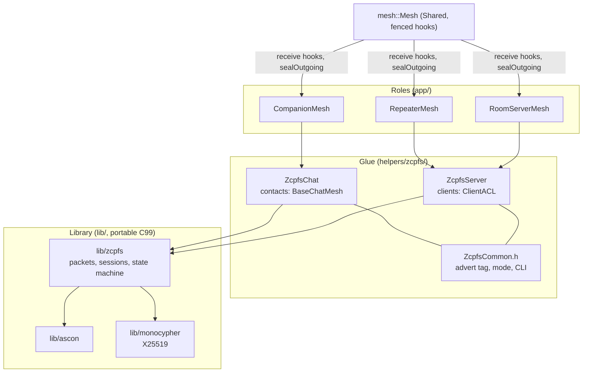
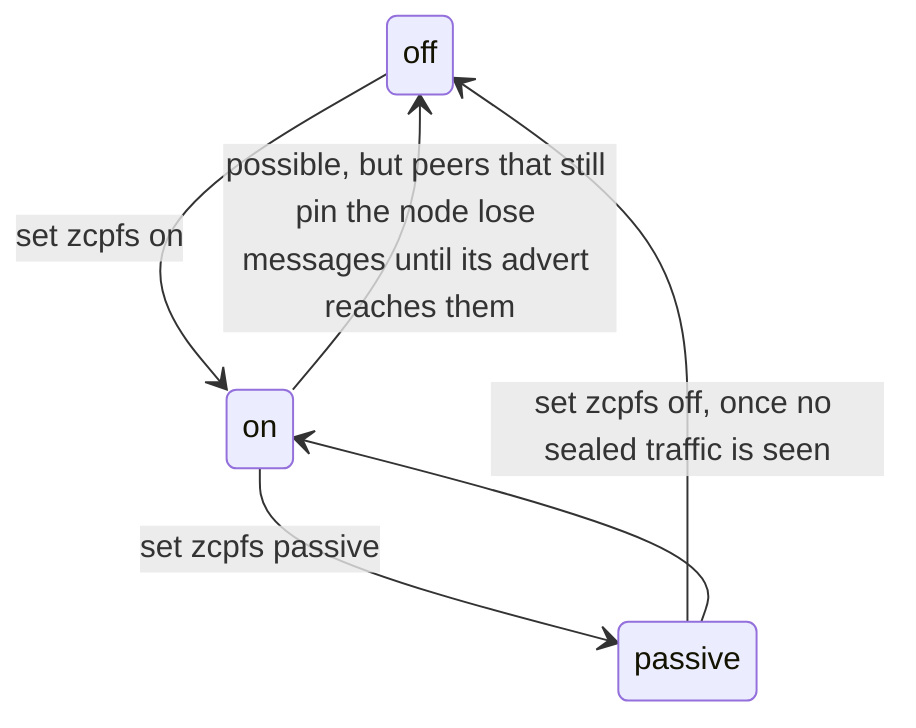

# zcpfs: high-level design

zcpfs gives direct messages between two ZephCore nodes forward secrecy, and seals requests, logins and,
where the members choose so, channel messages with a modern AEAD. It is built on top of MeshCore's packets, so nodes without it
are not affected and the phone apps notice nothing.

**Status:** experimental. Built only with `CONFIG_ZEPHCORE_ZCPFS=y` (default `n`), and switched on per node at
run time (`set zcpfs on`, default `off`). Companion, repeater and room server roles are done and have run on a
bench of three nodes beside an official MeshCore 1.18 companion. Neither the design nor the code has had a
cryptographic review.

This page is the overview for developers. The protocol itself is specified in `zephcore/lib/zcpfs/SPEC.md`,
the library in `zephcore/lib/zcpfs/README.md`, the firmware integration and every measurement in the area's
low-level design (`devdocs/lld/14-zcpfs.md`, kept local), and the components in
[ARCHITECTURE.md](ARCHITECTURE.md) section 4.8.1.

---

## 1. Why

MeshCore encrypts a direct message with AES-128-ECB under a key derived once from the two identity keys, and
authenticates it with a 2-byte MAC. Whoever records traffic today and gets one of the two private keys later
(a lost or seized device, a leaked backup) can read every message the pair ever exchanged. The 2-byte MAC can
be forged by trying. A login carries the password, encrypted under that same static key, to whoever holds the
addressed key.

zcpfs changes that for nodes that both have it:

| Traffic | Legacy MeshCore | zcpfs |
|---|---|---|
| Direct messages | static key, ECB, 2-byte MAC | per-message keys from a ratcheted session, Ascon-AEAD128, 8-byte tag; **forward secret** |
| Requests, responses, path returns | static key, ECB, 2-byte MAC | per-packet key from the static secret and a fresh nonce, 8-byte tag (no forward secrecy) |
| Login to a repeater or room | password sent, encrypted under the static key | password-authenticated key exchange: **the password never leaves the node**; the session that follows is forward secret |
| Channels (per channel, opt-in) | channel key, ECB, 2-byte MAC | per-message key from the channel key and a nonce, 8-byte tag (no forward secrecy) |
| Metadata (who talks to whom, when, sizes) | visible | still visible |

## 2. Requirements it was designed to

1. **No reserved bits** of the MeshCore format are taken, and no new packet types: zcpfs packets use the
   existing types and are told apart by their length.
2. **Transparent to the phone apps:** the companion protocol is unchanged; the app sends text and logins as
   before and gets the same pushes, ACKs and timeouts.
3. **Minimal airtime:** a sealed message costs about what a legacy one does; an ACK is 4 bytes instead of 6.
4. **Reliable over lossy LoRa:** sessions survive lost packets, reboots on either side and reordering.
5. **zcpfs never floods on its own.** Only the application's own send (a text, a login) may flood, exactly
   where legacy would. Retries, handshakes and repairs go direct.
6. **Bounded:** fixed memory per contact, rate limits derived from the LoRa preset, nothing a stranger can
   use to make a node flood without limit.
7. **Auditable:** the cryptography and the state machine are a portable C99 library without Zephyr or
   MeshCore inside; the firmware glue is a thin layer.

## 3. Building blocks

- **Identities:** the existing Ed25519 node keys, used as X25519 keys (as MeshCore already does for its
  shared secret). No new keys to manage.
- **AEAD and key derivation:** Ascon-AEAD128 with tags truncated to 8 bytes, and Ascon-CXOF128 as the one
  KDF, with a label per use (NIST SP 800-232), in `lib/ascon`.
- **Handshake:** two messages with the Diffie-Hellman terms of the Noise KK pattern (both static keys known in
  advance, one ephemeral each): mutual authentication and fresh keys in one round trip.
- **Session:** two hash chains, one per direction; each message steps its chain and the old key is erased. A
  window tolerates loss and reordering. Three slots (current, next, previous) let both sides switch to a new
  session without losing messages in flight.
- **Stateless mode:** requests, responses, path returns and channels are sealed with a key derived
  from a static secret and a random nonce: no state to lose, no forward secrecy.
- **Random numbers:** one generator per node, a hash-based DRBG over Ascon, seeded from the hardware RNG
  and a seed file that is replaced on every boot, so a weak RNG at one boot cannot repeat an earlier stream.
- **Login:** CPace-style PAKE. Client and server each multiply a one-time scalar onto a curve point derived
  from the password; they reach the same key only if they used the same password. The server answers with one
  branch per password it would accept; the client's first packet under the right branch confirms it.

## 4. Architecture



- **`lib/zcpfs`** knows packets and keys, not radios: the firmware hands it a packet and a view of the
  contact (key, shared secret, pinned, has a path, the send timeout), and it answers with what the packet was
  and, through four callbacks, what to send. It owns handshakes, retries, timers and limits. It keeps a fixed
  table of contact records (`CONFIG_ZEPHCORE_ZCPFS_PEERS`, about 2.4 kB each) and, on a server, two login
  offers. It is host-tested against the Python reference model's vectors and scenarios.
- **Hooks in `mesh::Mesh`** (Shared upstream file, every change fenced `// ZEPHCORE:` and compiled only with
  the switch). A packet for this node is offered to zcpfs *before* legacy decryption, because a sealed payload
  would simply fail the legacy MAC:
  - `onPeerSealedRecv`: `TXT_MSG`, `REQ`, `RESPONSE`, `PATH`, once per contact whose hash matches;
  - `onAnonSealedRecv`: an `ANON_REQ` (a login);
  - `onStrangerSealedRecv`: a `TXT_MSG` no contact claimed (a server's first packet from a client whose login
    is being confirmed);
  - `onPeerRecvDone`: the packet is finished;
  - `onGroupSealedRecv`: `GRP_TXT` and `GRP_DATA`, once per channel whose hash matches;
  - `sealOutgoing`, `sealGroupOutgoing`: `createDatagram`, `createPathReturn` and `createGroupDatagram` may
    build the payload sealed.
  An opened packet re-enters the normal legacy code as the plaintext legacy decryption would have produced,
  zero-padded to whole AES blocks, so message, request, CLI and login handling stays upstream's.
- **`ZcpfsChat`** (companions, contacts in `BaseChatMesh`) and **`ZcpfsServer`** (repeater and room, clients
  in `ClientACL`) translate between the two: contact views, the engine's callbacks into `sendDirect` and
  floods, ACK values into the tokens the app or the room expects, the legacy login response the app expects.
- **The roles** only add fenced calls: the advert tag, the ACK value of a sealed text, text going through the
  session, the timer, the CLI, and on servers which passwords give which role.

## 5. On the air

zcpfs packets are ordinary MeshCore packets. A node tells them from legacy ones by length: a legacy payload
is always whole AES blocks plus a fixed header, a zcpfs payload never is.

| Packet | MeshCore type | Size |
|---|---|---|
| Sealed text | `TXT_MSG` | plaintext + 10 |
| Handshake 1 / 2 | `REQ` / `RESPONSE` | 42 |
| Probe (finds a path) | `REQ` | 14 |
| Sealed request, response, path return | `REQ`, `RESPONSE`, `PATH` | plaintext + 16 |
| Login | `ANON_REQ` | 78 to a repeater, 82 to a room |
| Login reply | `RESPONSE`, or inside a path return | 45 (one branch), 87 (two) |
| ACK | `ACK` | 4 (legacy: 6) |

Every packet is unique on the wire (fresh nonce, ephemeral or chain key), so MeshCore's duplicate suppression
never eats a retry. No payload exceeds 176 bytes.

**Capability and pinning.** A node with zcpfs on appends one `0x00` byte after the name in its signed
advert; legacy parsers stop at it and show the name unchanged. A receiver that sees the tag **pins** the
contact (bit `0x80` of `ContactInfo.flags` on a companion, a reserved byte of the ACL file on a server). To a
pinned contact a node never sends legacy text, so an attacker cannot downgrade a conversation. A legacy
text to a contact that is not pinned carries a small **padding hint** where it costs no AES block; a zcpfs
receiver that sees it starts a handshake, so two zcpfs nodes that missed each other's adverts still find
each other. Only an
accepted (signed, newer) advert without the tag unpins: the key's owner went back to legacy. A server keeps
no adverts of its clients; it pins a client on a confirmed zcpfs login and unpins it on a legacy login.

## 6. Key flows

### 6.1 First message to a contact

```mermaid
sequenceDiagram
  participant A as Alice (app + node)
  participant B as Bob (node)
  Note over A,B: both pinned each other from tagged adverts
  A->>A: app sends text; no session, no path: hold it
  A-->>B: probe (flood, the app's send point)
  B-->>A: path return, sealed (flood)
  A->>B: reciprocal path (direct)
  A->>B: handshake 1 (direct)
  B->>A: handshake 2
  A->>B: held text, sealed under the new session
  B->>A: ACK (4 bytes); the app sees its usual confirmation
```

Every later message is one sealed packet and one 4-byte ACK. On the bench: first message confirmed in
2.7 s, later ones in under a second (SF7, 62.5 kHz).

### 6.2 Repair after a lost session

If a node reboots, sessions are gone (they are RAM only, on purpose). A sender without a session holds the
message and handshakes; a receiver that cannot open a text from a pinned contact starts the handshake itself.
The app's retry then goes through: one attempt is lost, nothing silently.

### 6.3 Login to a repeater or room

```mermaid
sequenceDiagram
  participant C as Client
  participant S as Server
  C->>S: ANON_REQ: client key, point Y_c (from password + one-time scalar), sealed flags + timestamp
  Note over S: authenticates the key, checks the offer limit, one branch per password it would accept
  S->>C: reply: one or two branches (point Y_j, sealed 6-byte response); flood answers flood, direct answers direct
  Note over C: opens the branch built from the same password, or none (wrong password: the app times out)
  C->>S: first text under that branch's session (a confirmation)
  Note over S: only now: client entered with the role, pinned, session current
```

A server answers at most two unconfirmed logins at a time (one place kept for clients it already knows), and
floods at most four replies to unknown clients in any 180 s; beyond that it answers over the reverse path
only. Legacy logins keep working both ways, unless a node turns them off (`zcpfs.legacylogin off`): a client
then never sends its password to a server without zcpfs, which is the only protection against a server that
simply hides the capability to read passwords, and a server never receives one in readable form.

### 6.4 Leaving: passive mode



`passive` stops the advert tag and starts nothing, but still reads and answers whatever arrives sealed, and
seals a text only to a contact that spoke sealed since the node's last advert. Peers unpin it as its untagged
adverts reach them; nothing is lost on the way.

## 7. State, timers and limits

- **Per contact** (fixed table, least valuable record reused first, a stranger can only take a free or idle
  one): the three session slots, outstanding handshakes, up to four held messages, a duplicate table.
- **Sessions end** after a day idle, a week of age, 8 unacknowledged texts, or 2^20 failed decryptions.
- **Timers are steps, not constants:** a step is one and a half times the firmware's own send timeout for the
  contact (at least 5 s), so intervals follow the preset and the path length. On SF7/62.5 kHz a step is about
  6 s for one hop and 17 s for five; on SF8 about 14 s and 36 s. A held message waits four steps, which is the
  timeout the app is given.
- **Rate limits:** handshake verifications 4 per second node-wide (burst 16); acted-on handshakes 3 per 30 s
  per contact; login offers 2 at a time, one step before a client may replace its own; flooded login replies
  to strangers 4 in any 180 s.

## 8. Configuration and CLI

| Build | `CONFIG_ZEPHCORE_ZCPFS` (default `n`), `CONFIG_ZEPHCORE_ZCPFS_PEERS` (default 4) |
|---|---|
| Run time, every role | `get zcpfs`, `set zcpfs on\|passive\|off` (default off, stored in `prefs.json` as `zc.zcpfs`) |
| Diagnostics | `get zcpfs.status`: mode, pins, records, sessions, packets in and out, and on servers the login counters and the last login's route |
| Channels, companion | `get zcpfs.channel`, `set zcpfs.channel <name\|index> off\|on\|strict`: sends sealed (`on`), or also refuses legacy (`strict`); only while the mode is on |
| Legacy logins, every role | `get zcpfs.legacylogin`, `set zcpfs.legacylogin on\|off` (default on): off on a client never sends a password to a server without zcpfs; off on a server drops legacy logins unread; only while the mode is on |

Cost with four contact records, RAK4631: companion about 14.7 kB flash and 10.2 kB RAM, repeater and room
server about 18 kB flash and 11.5 kB RAM.

## 9. Working on it

- **The engine never floods by itself.** `zcpfs_send_text` and `zcpfs_login_send` are the only calls that may
  flood, and only when there is no path, as legacy would. Anything that floods from a timer or in response to
  a packet is a bug.
- **No limit may react to unanswered replies.** On a lossy mesh a lost reply and an attacker's guess look the
  same; limits count what was sent, never what came back.
- **Numbers come from the LoRa presets.** Intervals and limits are derived from the firmware's airtime and
  timeout formulas, not chosen round.
- **Shared files** (`Mesh.cpp/h`, `BaseChatMesh`, `ClientACL`) keep upstream's text; every zcpfs line is inside
  `#ifdef CONFIG_ZEPHCORE_ZCPFS` and fenced `// ZEPHCORE:`. With the switch off the build must not change.
- **Two traps found on hardware:** `Packet::markDoNotRetransmit()` overwrites the header (read the route type
  first), and the legacy view of an opened packet must be padded to whole AES blocks.
- **Tests:** `tests/unit/zcpfs_tests.cpp` (every specification vector, tampering of every byte) and
  `zcpfs_peer_tests.cpp` (whole nodes over a simulated lossy link), run with ASan and UBSan in CI; the Python
  model in `lib/zcpfs/ref/` generates the vectors. The glue has no host tests yet; it is verified on the bench.
- **Changing the protocol:** the specification first, then the model and its vectors, then the C library and
  its tests, then the glue; record the change in the LLD.

## 10. Open

- Host tests of the glue; tests on lossy, multi-hop and SF8 links and with the phone apps over BLE.
- An ADR before the build switch defaults to on anywhere, and a cryptographic review.
